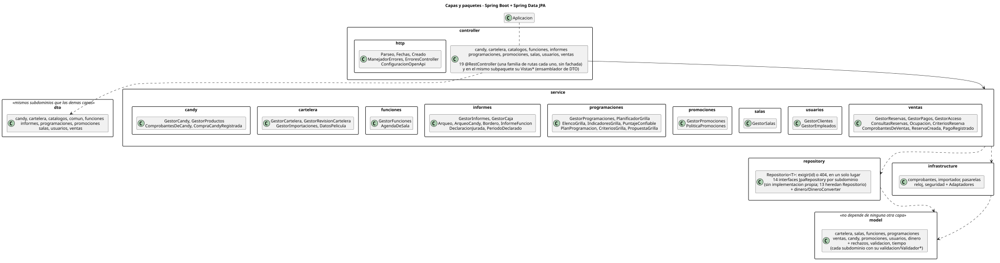
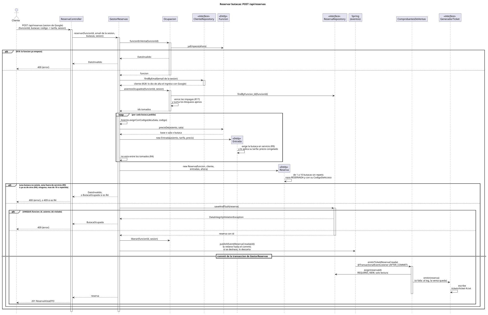
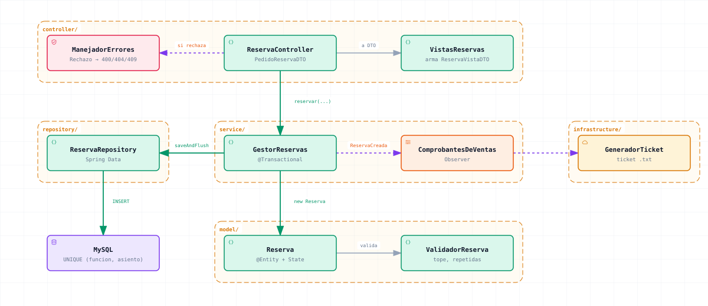
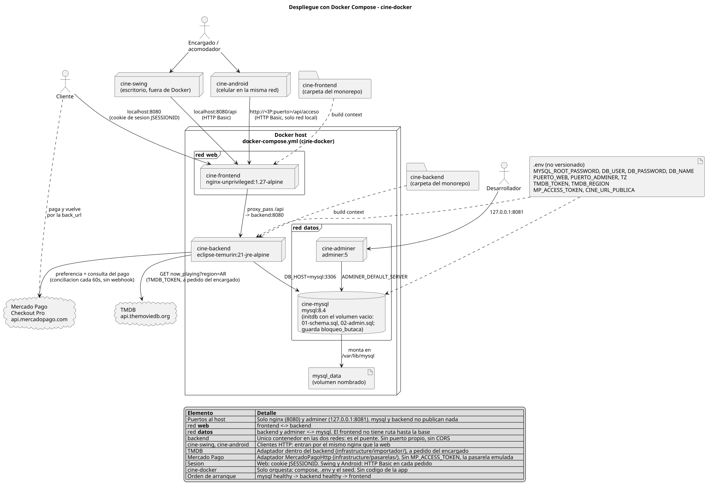

# Arquitectura

Un backend con todas las reglas y tres clientes que no deciden nada. El detalle de cada decisión está en el
[manual](_other/docs/manual/index.html); acá, el mapa para orientarse en el código.

## Cómo se conecta todo

Todo pasa por el contenedor de Render: ningún cliente llega a MySQL ni a un servicio externo con un secreto. El navegador solo va a Google y a Mercado Pago redirigido, y vuelve con un código o un id que el backend verifica él mismo.

| Ingresar con Google (rama `t79-google`) | Acceso en la puerta |
|---|---|
|  |  |

| Secreto | La da | Se carga en | La usa |
|---|---|---|---|
| `SPRING_DATASOURCE_*` (local: `DB_*`) | Aiven (local: se inventa) | Environment de Render (local: `cine-docker/.env`) | Hikari, JDBC con TLS |
| `MP_ACCESS_TOKEN` | Mercado Pago, credenciales de prueba | Render y `.env` | `MercadoPagoHttp`; vacío, pasarela emulada |
| `TMDB_TOKEN` | TMDB | Render y `.env` | El importador |
| `GOOGLE_CLIENT_SECRET` (el `_ID` es público) | Google Cloud Console | Render y `.env` | `oauth2Login`, canje del código |

`render.yaml` nombra cada variable con `sync: false`: el nombre está en el repo, el valor solo en el panel. El repo es público y se sube a mano; Render construye el `Dockerfile` con Manual Deploy.

## Capas del backend

`ar.uade.cine` tiene seis carpetas, y las seis son capas; al lado solo está `Aplicacion.java`, que arranca.

| Capa | Qué hay | Puede importar |
|---|---|---|
| `controller/` | `*Controller` y su ensamblador `Vistas*` por subdominio | `model`, `dto`, `service`, `infrastructure`, `controller` |
| `dto/` | `Pedido*DTO` (entra) y `*VistaDTO` (sale), sin lógica | `model`, `dto` |
| `service/` | Un `Gestor*` `@Service` por caso; todas las reglas que necesitan la base o el reloj | `model`, `repository`, `infrastructure`, `service` |
| `model/` | Entidades, Value Objects, enums con estado y `Validador*` | `model` |
| `repository/` | `Repositorio<T>` (con `exigir`) + un `*Repository` de Spring Data por entidad | `model`, `repository` |
| `infrastructure/` | Puertos hacia afuera (comprobantes, imágenes, importador, pasarelas, reloj) y `seguridad/`; `Adaptadores` elige cada implementación | `model`, `repository`, `service`, `infrastructure` |

La columna de la derecha es la tabla `PERMITIDO` de `ArquitecturaTest`, que corre en cada `mvn test` y además falla si:

- un `service/` o un `controller/` habla con la base por debajo del repositorio (`jakarta.persistence`, JDBC, `java.sql`);
- alguien fuera de `infrastructure/Adaptadores` nombra un adaptador concreto (`comprobantes.txt`, `imagenes.base`, `importador.tmdb`, `pasarelas.emulada`, `pasarelas.mercadopago`) en vez de su puerto;
- la raíz de un puerto tiene algo más que su interfaz y su excepción;
- alguien tira `new IllegalArgumentException(` en vez de un `Rechazo` (`DatoInvalido` 400, `RecursoNoEncontrado` 404, `ConflictoDeNegocio` 409);
- un controller contesta `ResponseEntity<Object>`.

Romper una regla es cambiar la tabla a mano, a propósito.

## Subdominios

Todas las capas usan la misma lista: sabiendo el subdominio se sabe el paquete en cualquiera.

| Subdominio | Qué resuelve |
|---|---|
| `cartelera/` | Películas, buzón de revisión de lo importado de TMDB |
| `salas/` | Salas, butacas y fuera de servicio |
| `funciones/` | Funciones sueltas y la agenda de cada sala |
| `programaciones/` | Grillas y el planificador de la semana |
| `ventas/` | Reservas, bloqueo de butacas, cobro, checkout y acceso por código |
| `promociones/` | Los tres tipos de promoción y la mejor al cobrar |
| `candy/` | Carta, combos y ventas de mostrador |
| `informes/` | Borderó, recaudación, declaración jurada y caja del día |
| `usuarios/` | Clientes, empleados y la cuenta del cliente |
| `imagenes/` | Imágenes de promociones y productos: `POST /api/imagenes` las valida (`ArchivoDeImagen`: JPG, PNG o WEBP, hasta 2 MB) y `AlmacenDeImagenesEnBase` las guarda en la tabla `imagen`. Solo propias: una URL ajena puede desaparecer o rastrear |

Transversales, solo donde hacen falta: `catalogos/` (enums que la API expone), `dinero/`, `rechazos/`, `validacion/`, `tiempo/` y `controller/http/`, que tiene `Parseo`, `Fechas`, `Creado` (la política de respuestas), `ManejadorErrores` y `cuerpo/`: una Chain of Responsibility (`LecturaDelCuerpo` y sus eslabones `SinCuerpo`, `JsonMalFormado`, `RaizQueNoEsObjeto`, `CampoConValorInvalido`) que convierte un cuerpo ilegible en un 400 que dice qué corregir.

## Flujo de una venta

Para seguirla en el código, en este orden:

1. `cine-frontend/src/compra/funcion/Funcion.jsx`: el mapa; cada butaca trae `precios` por tarifa y `compra/bloqueo.js` la bloquea (`bloquearButacas`) mientras se elige.
2. `cine-frontend/src/compra/confirmar/useReservar.js` → `crearReserva` en `src/api/api-http.js`.
3. `controller/ventas/ReservaController` → `service/ventas/GestorReservas.reservar`: valida función (R19), butacas (R9) y que estén libres (R4).
4. `model/ventas/Reserva`: crea sus `Entrada` (Creador) y cada una calcula su precio con la tarifa.
5. `GestorReservas` publica `ReservaCreada`; `ComprobantesDeVentas` emite el ticket después del commit (Observer).
6. Cobro: `PagoController` → `GestorPagos.cobrar` en caja, o `iniciarCheckout` / `retornarDeCheckout` con Mercado Pago (`PasarelaPagos` → `MercadoPagoHttp`); `ConciliacionPagos` cobra lo aprobado aunque el comprador no vuelva.
7. Puerta: `AccesoController` → `GestorAcceso` busca la reserva por el código del QR y `Reserva` registra el ingreso (R18).

## Clientes

| Cliente | Para quién | Cómo habla con la API | Mapa |
|---|---|---|---|
| `cine-frontend/` | Cliente | `src/api/api-http.js`, cookie de sesión | [estructura](_other/docs/diagramas/front-estructura.svg), [flujo](_other/docs/diagramas/front-flujo.svg) |
| `cine-swing/` | Encargado y acomodador | `api/ClienteHttp` + una `Api<Subdominio>`, Basic en cada pedido | [un pedido](_other/docs/diagramas/swing-pedido.svg), [pantallas](_other/docs/diagramas/swing-pantallas.svg) |
| `cine-android/` | Acomodador | `POST /api/acceso` con Basic | [README](cine-android/README.md) |

El contrato de los tres es [`API.md`](cine-frontend/API.md).

## Despliegue

Producción, en el [mapa](#cómo-se-conecta-todo): el `Dockerfile` de la raíz compila el front y lo sirve el backend, un origen `https` para la cookie, la vuelta de Mercado Pago y la de Google. `render.yaml` es el Blueprint: servicio, health check y variables.

Local (`cine-docker/`): nginx sirve el front y reenvía `/api` al backend (`cine-backend/Dockerfile`); MySQL en una red aparte.

La base nace de `cine-backend/src/main/resources/db/schema.sql`; una base existente se pone al día con
`db/migraciones/NN-*.sql` en el orden del número (en Aiven, `cine-docker/aiven/migrar-aiven.sh <número o nombre>`).
Pasos completos: [Despliegue](_other/docs/manual/index.html#despliegue) en el manual.
